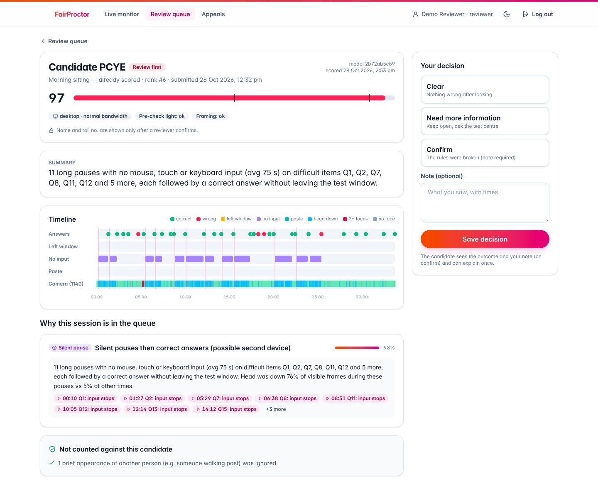
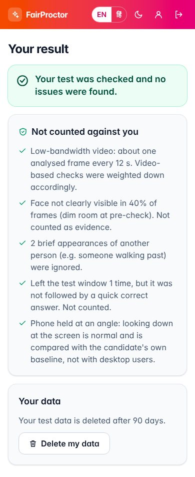
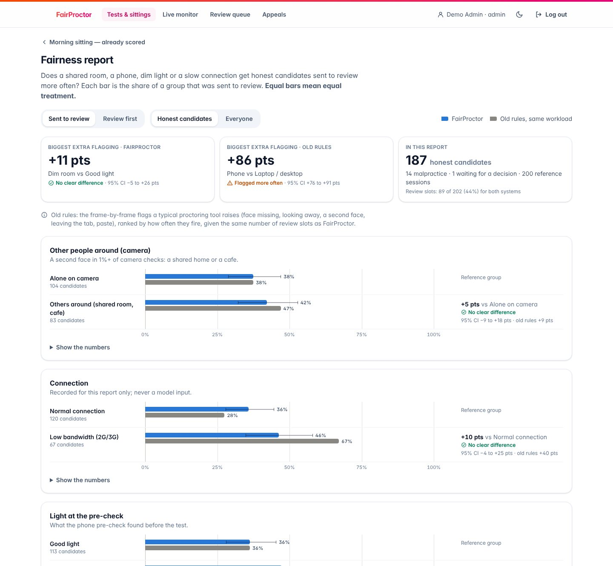
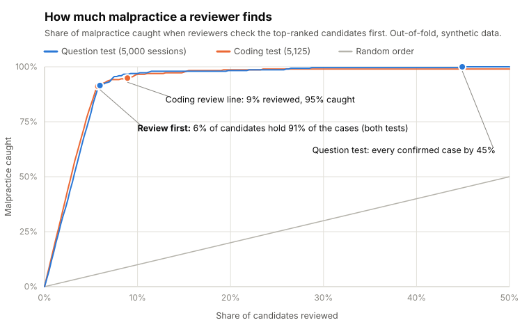
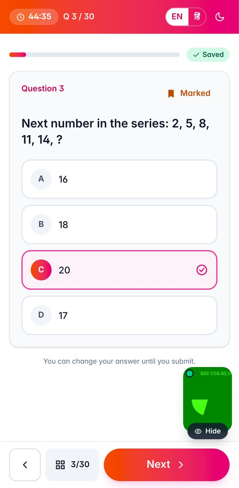
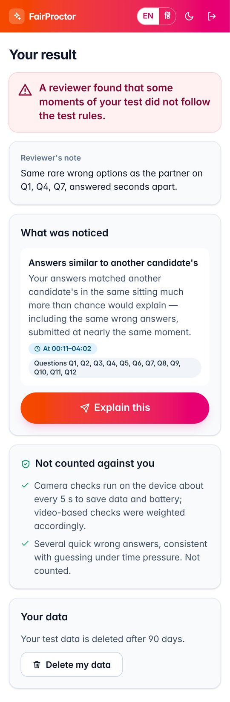
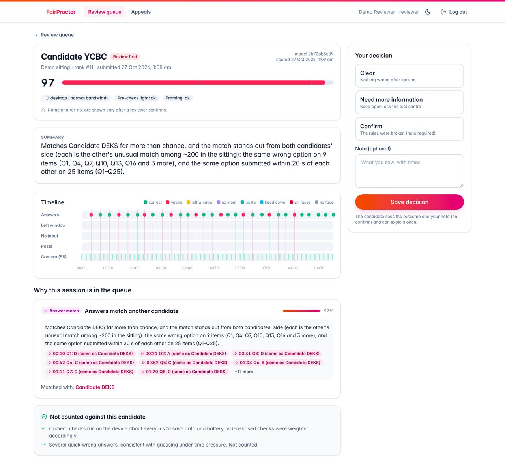
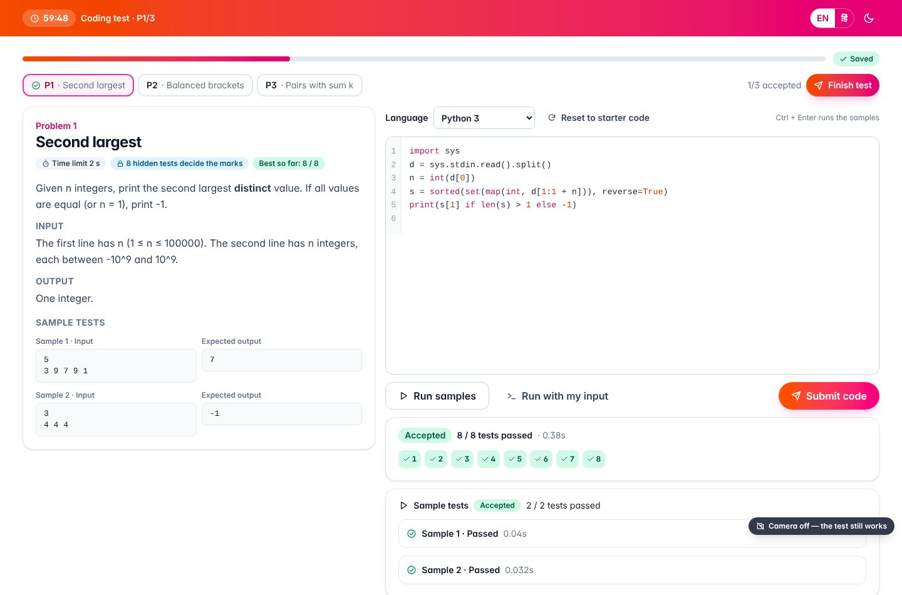
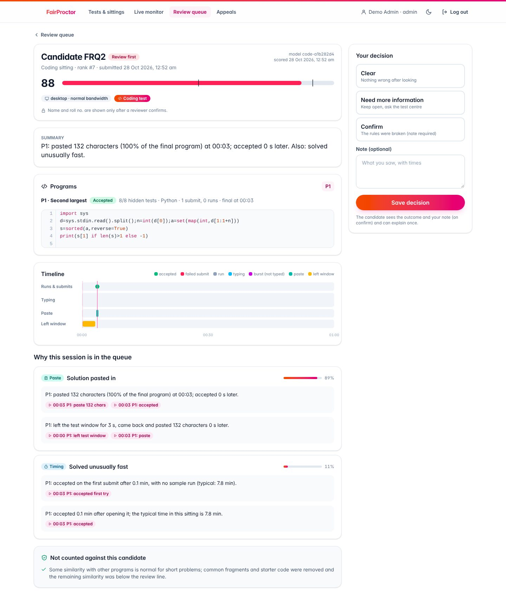

# FairProctor — proctoring that does not punish a shared room

Remote tests in India are often taken on a phone, over 2G, in a dim room that other people walk through. Most
proctoring tools flag exactly those candidates. FairProctor separates **the environment** (dim room, shared home,
cyber cafe, phone held low, 2G video) from **behaviour** (relayed answers, a second phone, searching, pasting, a
helper, copied code). It ranks the review queue so reviewers see the likeliest real malpractice first, each with
time-stamped evidence, and it tells every candidate what was noticed and what was *not* counted against them.

Built for Integraminds · Mission Bharat.

| | |
|---|---|
| **91% of the cases in the top 6%** | Reviewers start with *Review first*: about 6% of candidates, holding 91% of the malpractice at 90% precision, in the question test and the coding test alike. |
| **No penalty for a 2G connection** | Honest low-bandwidth candidates: the old frame-by-frame rules send them to review 44 points more often than candidates on a normal connection; FairProctor, 3 points (5,000 sessions). A fairness report shows this for every sitting. |
| **Every flag shows its evidence** | Times, question numbers and moments on a timeline for the reviewer; for the candidate the same in plain English or हिन्दी, with what was not counted and a way to reply. |

All numbers are out-of-fold on synthetic data (see [what that does and does not prove](#what-the-synthetic-data-does-and-doesnt-prove)).

## Try it in two minutes

```bash
docker compose up --build          # PostgreSQL + the app with demo data → http://localhost:8000
```

Or without Docker (Python 3.10+):

```bash
pip install -r requirements.txt
python -m backend.scripts.seed_demo --reset
python -m uvicorn backend.app:app --port 8000      # → http://127.0.0.1:8000
```

The login page has a **Try the demo** box: one click to be the admin, the reviewer, a new candidate (question or
coding test), or one of two candidates from a finished sitting. **[DEMO.md](DEMO.md)** has the logins and a
three-minute walkthrough:

- **Rahul** (a second phone below the camera) is at the top of the queue, with the evidence;
- **Priya** (honest; 2G, a phone held low, a dim shared room) is cleared, and the system lists what it did not count;
- the **fairness report** shows who gets flagged by group, against the old rules at the same workload.

The old frame-by-frame rules would have put Priya in the top 10 of that sitting and Rahul around #80.

| Reviewer: Rahul's evidence | Priya's result (phone) | Fairness report |
|---|---|---|
|  |  |  |

<picture>
  <source media="(prefers-color-scheme: dark)" srcset="docs/charts/review-curve-dark.svg">
  
</picture>

The numbers behind the chart: [`docs/charts/review-curve.csv`](docs/charts/review-curve.csv)
(rebuild with `python scripts/make_readme_chart.py`).

## What's in the box

| Part | Where | What it does |
|---|---|---|
| Scoring model | `fairproctor/` | Features from answers, timing, focus, paste, cross-candidate answer matching and video analysis results → CPU gradient-boosted trees → calibrated 0–100 score + explanation |
| Scoring service | `service/app.py` | REST API: review queue, session detail, live scoring, reviewer decisions, candidate appeals, deletion |
| Reviewer console | `/console` | Ranked queue, answer-sheet timeline, reasons with clickable moments, "not counted" context, decision log |
| Candidate page | `/candidate/<id>` | Plain-language reasons (English / हिन्दी), what was not counted, appeal form. Never shows other candidates' IDs |
| Pre-check | `/precheck` | Phone-browser check of connection, light, backlight, framing, sharpness, people in view; fixes in plain English / हिन्दी. No image leaves the phone |
| Results | `reports/RESULTS.md` | Every "Done when" criterion, with numbers |
| Fairness report | `backend/services/fairness.py`, `/admin/sittings/:id/fairness` | Per sitting: share of each group (room, connection, light, device, framing; language for code) sent to review, FairProctor vs the old rules at the same workload, with 95% intervals |
| Demo story | `backend/scripts/make_story.py`, [`DEMO.md`](DEMO.md) | A scored sitting with Priya and Rahul, one-click demo logins on the login page |
| Pilot kit | [`pilot/`](pilot/PILOT.md) | A real pilot in an afternoon: role cards (English + हिन्दी), consent form, sealed key, a rehearsal with simulated participants, results with intervals, data deletion |
| Web app backend | `backend/` | FastAPI + PostgreSQL + JWT: logins with roles (no self sign-up), tests, sittings, exam event stream, scoring at close, review queue, appeals |
| Web app frontend | `frontend/` | React + Vite + Tailwind: candidate test on a phone (English / हिन्दी), reviewer queue and evidence, admin setup |
| Coding tests | `backend/services/runner.py`, `coding.py`, `frontend/src/pages/exam/Coding.tsx` | A separate coding-only test: Python, C++, Java, JavaScript; run on samples, judged on hidden tests on the server |
| Coding integrity model | `fairproctor/coding*.py`, `codesim.py` | Code similarity between candidates (MOSS-style), paste and typing pattern, timing → its own trained model → `reports/CODING_RESULTS.md` |

## Rebuild the model and the research console

The trained models ship in `backend/model/`; this rebuilds the question-test model from scratch and runs the
original research console. Needs Python 3.10+ (`pip install -r requirements.txt`). No GPU.

```bash
python data/generate.py --out data/sample --n 5000      # synthetic sample (~1 min)
python -m fairproctor.pipeline --data data/sample --out artifacts   # features, model, evaluation (~2 min)
python -m uvicorn service.app:app --port 8000
python scripts/smoke_test.py                            # in another terminal
```

Open `http://localhost:8000/console`.

**Phones need HTTPS for the camera.** To try the pre-check on a real phone, put the service behind HTTPS, for example with `cloudflared tunnel --url http://localhost:8000` or `ngrok http 8000`, and open `/precheck` on the phone.

## Web application backend (`backend/`)

**FastAPI + PostgreSQL + JWT.** Logins for admin, reviewer and candidate (candidates are imported
by the admin with roll no. + login code; reviewers are added by the admin; admins are created with
`python -m backend.scripts.create_admin`), test and sitting setup, the exam event stream from the candidate's browser, scoring of a
whole sitting when it closes (with the engine above), the review queue, results and appeals, deletion and retention.
Interactive API docs at `/docs`; reference in [`docs/API.md`](docs/API.md).

```bash
pip install -r requirements.txt
# the trained model ships in backend/model/ (rebuild it with "Run it" above if you change the engine)
python -m backend.scripts.seed_demo --reset          # demo data: logins, 30-question test + coding test, two live sittings, reference sessions
python -m uvicorn backend.app:app --port 8000        # http://127.0.0.1:8000/docs
python -m unittest backend.tests.test_flow backend.tests.test_coding backend.tests.test_runner -v   # tests (temporary SQLite)
```

Locally it uses a SQLite file, so nothing else is needed. With `DATABASE_URL=postgresql://...` (Neon, Render) the
same code runs on PostgreSQL; set `FP_TEST_DATABASE_URL` to run the tests there too (they wipe that database).
Production settings are listed in [`.env.example`](.env.example).

| Folder | What lives there |
|---|---|
| `backend/routes/` | FastAPI routers: `auth` (login per app, logout; sign-up is off), `admin`, `exam` (candidate), `review` |
| `backend/services/` | The logic and its SQL: `exam` (join, start, idempotent event ingestion, result, appeal), `admin`, `scoring`, `live` (live monitor), `privacy`, and for coding tests `runner` (compile, run, judge), `coding` (problems, run, submit, marks), `coding_score` |
| `backend/http.py` | JWT Bearer auth, role checks, the one error format |
| `backend/db.py` | PostgreSQL / SQLite connection wrapper, migrations, bulk COPY |
| `backend/migrations/` | `postgres/` and `sqlite/` schema files, applied at start |
| `backend/jobs/worker.py` | In-process job queue: scoring at close, daily retention |
| `backend/schemas.py` | Every request body (pydantic); unknown fields are rejected |

Design rules kept in code: passwords and login codes are scrypt-hashed; JWTs are signed (HS256) and revocable;
the correct answers never leave the server; images never reach it (frame numbers only); paste text is never stored
(length only); bandwidth and device are stored for fairness reports but are not model inputs; reviewers see other
candidates only as pseudonyms, and a candidate's name only after a confirmed finding.

## Web application frontend (`frontend/`)

**React 19 + TypeScript + Vite + Tailwind (shadcn/ui-style components).** Phone-first candidate flow in English and
हिन्दी (consent, pre-check, one question per screen, offline-safe answers, result and appeal), the reviewer's queue
and evidence timeline, and the admin's test and sitting setup. Light and dark mode. Details in
[`frontend/README.md`](frontend/README.md).

```bash
cd frontend && npm install && npm run dev      # http://localhost:5173, /api proxied to the backend on :8000
```

A Playwright test in [`e2e/`](e2e/README.md) drives the whole demo in Chromium (candidate on a phone, two copying
candidates, admin close & score, reviewer decision, appeal) and saves screenshots.

| Candidate | Reviewer |
|---|---|
|   |  |

More in [`docs/screenshots/`](docs/screenshots).

## Two apps: candidates and staff

One build, two frontends, one backend and one address (so a single ngrok link serves both):

| | Candidate app | Staff app |
|---|---|---|
| Address | `/` (`/login`, `/exam/…`, `/account`) | `/staff/login`, `/admin/…`, `/review/…`, `/staff/account` |
| Login | Roll no. + login code only | Email + password only |
| Accounts | Imported by the admin (CSV), new code from the sitting page | Reviewers: added by an admin (*Tests & sittings → Staff accounts*). Admins: `python -m backend.scripts.create_admin --email … --name …` (`--reset-password`, `--list`) |

There is no sign-up (`/api/auth/signup` and `/api/exam/join` answer `410 signup_disabled`; `ALLOW_SIGNUP=1` brings
them back for old setups). The server refuses a staff login on the candidate app and the reverse (`403 wrong_app`), each
app keeps its own login in the browser, and candidates never download the staff screens. In demo mode the candidate
login page makes a fresh demo candidate (`POST /api/demo/candidate`) and the staff login page has the demo admin and
reviewer.

## Proctoring rules (fixed limits, next to the model)

The device checks the camera every second; the server stores each event, enforces the same limits and keeps the reason.

| What | On the device | Limit |
|---|---|---|
| A second face for **5 s** in a row | Counted warning ("1 of 5") and snapshots | More than 5 episodes ends the test |
| No face for 5 s | Notice and snapshot | Never ends the test |
| A phone in at least 2 of 5 s (fast link only) | 1st: warning and snapshots | 2nd ends the test |
| Leaving the test tab or app | Warning with the count | More than 5 ends the test |
| Logging in again during the test | Counted | Never ends it; 2 or more go to review |
| Disconnects | Each offline period is recorded | More than 5, with answers right after reconnecting: flag for review |

An ended test is submitted as it stands and always goes to a reviewer (at least *Review*), who sees a
**Proctoring rules** card and confirms or clears it; the candidate sees the reason and can reply. Questions come in a
different order for every candidate (a fixed shuffle per session, the same after a refresh).

**Reopening a test a rule ended.** A rule can be wrong (a TV remote taken for a phone, a sibling walking past), so an
ended test is never final while the sitting is open. The live monitor lists every test a rule ended; **any** reviewer
looks at the snapshots and the counts and clicks **Reopen the test** with a short note. The candidate (whose page keeps
checking) sees "A reviewer reopened your test" and continues: answers are kept, the minutes it stood closed are added to
the deadline (never past the sitting's end), and the rule that ended it counts from 0 again. With several reviewers on
one sitting, only the first reopen goes through (one atomic update); the others are told it was already reopened.
Every reopen (who, when, note, minutes given back) is in the audit log and on the reviewer's **Proctoring rules** card,
and the test still goes to review after scoring. Photos of the ending moment are accepted for 90 s after the end, so
the reviewer has them. Once the sitting closes, a reopen is refused (`window_closed`). Limits are in
`backend/config.py` and `frontend/src/lib/proctorRules.ts`; tests: `backend/tests/test_rules.py`, `e2e/rules.mjs`.

## Microphone check (speech-like sound, support only)

With the candidate's permission (a separate prompt, so saying no never blocks the camera), the phone listens for
**speech-like sound**: every 5 s it decides yes or no with the five-part detector measured on ESC-50 and MUSAN
(loud enough above the room's own background, voiced at 80–400 Hz, a 2–8 Hz syllable rhythm, moving pitch, short
voiced bursts). No sound is recorded, stored or sent; only a "yes" with the voiced seconds is sent. The phone runs a
TypeScript port that gives the same verdict as the validated Python detector on 499 of 500 ESC-50 clips and all
1,671 MUSAN windows (`reports/BROWSER_SPEECH_CHECK.md`). It switches itself off on a phone too slow for it.

That detector catches about 87% of talking, but it also takes about a quarter of ordinary home sounds (a rooster, a
dog, laughing) and any TV for talking, and it cannot tell who is speaking. So **sound never changes a score, band or
the queue order** (a test scores the same sitting with and without the sound events). When the score already shows
silent pauses followed by correct answers on hard questions, speech-like sound during those pauses is added to that
reason as a supporting line for the reviewer; otherwise the candidate and the reviewer see it under "not counted".
The reviewer's timeline has a **Sound** lane, and the live monitor a neutral "speech-like sound" chip (not an alert).

`FP_MIC=off|optional|required` (default `optional`; `required` means the test cannot start without it). Whispering is
mostly unvoiced and is not measured: the system must not be described as catching whispered help. Code:
`frontend/src/lib/speech.ts`, `frontend/src/lib/mic.ts`, `backend/services/audio.py`; tests: `backend/tests/test_audio.py`,
`e2e/audio.mjs` (a MUSAN reading-aloud recording played into the fake microphone); dataset check:
`node analysis/browser_speech_check.mjs --esc50 <ESC-50-master> --musan <musan>` (or `--selftest`).

## Device decided automatically: Safe Exam Browser on laptops, kiosk mode on phones

The page and the server work out which device the test is written on, and pick the lock-down for it:

| Device | What runs |
|---|---|
| Inside [Safe Exam Browser](https://safeexambrowser.org) | SEB (the page adds nothing of its own) |
| Phone or tablet browser | **Kiosk mode**: full screen from the Start tap, the screen kept on, portrait on phones; leaving full screen shows a "Back to full screen" bar |
| iPhone | Screen kept on (iPhone browsers have no full screen for web pages) |
| Laptop or desktop, sitting requires SEB | Install steps and an "Open in Safe Exam Browser" link; a normal browser cannot start |
| Laptop or desktop, SEB not required | Kiosk mode |

An admin only chooses **"Require Safe Exam Browser on laptops"** per sitting (off by default; setup:
[`docs/SEB.md`](docs/SEB.md)). SEB does not exist on Android, so phones are let in with kiosk mode instead of being
refused. The device comes from the request (User-Agent, the `Sec-CH-UA-Mobile` client hint) and is checked against
what the page measures (touch points, screen size, pointer). A browser can pretend to be a phone: when the request
says "phone" but the page looks like a laptop, the session gets a **device check** flag and goes to a person (it is
let in, because it may be a real tablet, and never ended).

A web page cannot lock a phone: other apps, notifications and split screen still work. So kiosk mode is a deterrent
and a record, not a lock: leaving full screen is noted on the reviewer's timeline ("Full screen" lane) and in the live
monitor, and is **never a rule** (on a phone a swipe, a notification or a call does it). Switching to another app is
still counted by the tab-switch rule as before. `FP_KIOSK=off` switches kiosk mode off. Code:
`backend/services/device.py`, `frontend/src/lib/kiosk.ts`; tests: `backend/tests/test_device.py`, `e2e/kiosk.mjs`.

## Coding tests

An admin creates a test of kind **Coding** and uploads its problems as JSON (title, statement, allowed languages,
time limit, starter code, sample tests shown to candidates, hidden tests, and an optional reference solution that must
pass every test before the upload is accepted). Candidates are added to the sitting as usual and get a coding screen:
problem tabs, statement and samples, a code editor (Python 3, C++17, Java, JavaScript/Node), **Run samples**,
**Run with my input** and **Submit**. Submissions are judged **on the server** against hidden tests; only pass / fail
per test comes back, never the tests. Each problem is worth 100 marks, shared by its hidden tests; the best
submission counts.

**The runner** (`backend/services/runner.py`) compiles and runs each program in a fresh temporary folder with a CPU
and wall-clock limit (the whole process group is killed), 256 MB memory, a 64 KB output cap, a 1 MB file-write cap,
a clean environment, and, on Linux as root, the unprivileged `nobody` user and a process limit. At most two runs at a
time (`FP_RUNNER_SLOTS`), one per candidate. A language whose compiler is not installed is hidden from candidates.
On Windows only the timeouts and output cap apply. For a large public deployment put the runs behind a jail such as
isolate, nsjail or Judge0 (the runner does not cut the network).

**Integrity for code** uses its own trained model (`fairproctor/coding.py`, `backend/model/coding_model.pkl`):

| Signal family | What it looks for |
|---|---|
| Code matches another candidate | MOSS-style fingerprints (`fairproctor/codesim.py`): names, numbers and spacing are ignored, starter code and lines most candidates share (reading input) are removed; plus a verbatim check. The reviewer sees both programs side by side with the matching lines |
| Solution pasted in | Share of the final program that arrived by paste, a big paste soon accepted, a paste right after leaving the test window |
| Code not typed normally | Characters that were never typed (pasted or dropped), long runs typed with no corrections, a burst after a long idle period |
| Solved unusually fast | Accepted far faster than others in the sitting, on the first try with no sample run |

The editor sends typing **counts** every 5 s (typed, deleted, key presses, largest insert), never keystrokes. Moving
your own code with small pastes, a quick look away, or being a fast expert are treated as normal. On 5,125 synthetic
coding candidates (`reports/CODING_RESULTS.md`): AUC 0.989, 95% of malpractice caught while sending 8.9% of candidates
to review (3.7% of honest candidates); a simple "any 50+ character paste or tab switch" rule flags 79% of honest
candidates. These are synthetic numbers and optimistic.

Rebuild the coding model with `python -m fairproctor.coding_pipeline --out backend/model`; the demo problems with
`python -m backend.scripts.coding_demo`.

| Candidate | Reviewer |
|---|---|
|  |  |

## Where the ML model runs

| When | What runs | Who sees it |
|---|---|---|
| During the test, in the browser | No model. The page records answers, timing, leaving the tab, pauses, paste length, and camera numbers (faces, head direction, light) from an on-device face detector; in a coding test also typing counts. Gentle live notices tell the candidate what was recorded (left the screen, no face, a second person, paste) | Candidate |
| During the test, on the server | **The trained model** (`fairproctor/model.py`: gradient-boosted trees + calibration, `backend/model/model.pkl`) re-scores everyone's answers so far, at most every 45 s, from 3 answers, in `backend/services/live.py`. For a coding sitting the **coding model** (`backend/model/coding_model.pkl`) does the same on the programs and typing so far | Live monitor (`/review/live`) for reviewers and admins, with an alert feed |
| When the admin presses **Close & score** | The same model on the complete sitting (`backend/services/scoring.py`, or `coding_score.py` for coding), with explanations | Review queue, then the candidate's result |

The live risk is an early signal for watching; only the close-of-sitting score goes to the queue and the
candidate, and only a human reviewer can confirm a finding.

## How the score works

**1. Environment is context, never evidence.** Video brightness, blur, frame rate and face visibility go into the model as context features with no monotonic push. Before scoring, the model's raw score is adjusted by subtracting what the environment alone would produce for an ordinary candidate:

```
score = f(behaviour, environment) − [ f(honest behaviour, environment) − f(honest behaviour, typical environment) ]
```

So a dark room or a 2G link can change *how much a video signal is trusted*, but can never add suspicion by itself. Bandwidth class and device type are **not** model inputs at all, because they are a proxy for where someone lives.

**2. Missing video is not evidence.** If no frames arrived during a pause, that signal is set to the honest baseline. Without this, a tree model learns that "no video" is risky. We saw exactly that during development; it cost low-bandwidth candidates several points of false-flag rate.

**3. Flags become episodes.** Forty "face missing" frames in a row are one episode. A person walking past for six seconds is one short appearance, and is ignored unless it persists for 25 s+ while answers are being given.

**4. Signals that don't need a camera carry most of the weight:**

| Signal family | What it looks for | Catches |
|---|---|---|
| Silent pauses then correct answers | No mouse/touch/key input for 20 s+ on a hard item, no window change, then a correct answer; head-down rate during those pauses vs the candidate's *own* baseline | Second phone below the frame |
| Answer timing | Hard items right far faster than typical; answers far faster than the candidate's own pace (not end-of-test rushing); person-fit (hard right, easy wrong) | Relayed answers, helpers |
| Answers match | Rarity-weighted identical answers (a shared *rare wrong* answer counts a lot, a shared popular one barely); the same option within 20 s, ignoring the opening items everyone answers together; pair strength measured from **both** candidates' side; mutual matches grouped into rings | Collusion rings, including the ring "source" who answered honestly |
| Leaving the test window | Focus lost, then a correct answer on a hard item within 15 s of returning | Searching |
| Pasted text | Paste size (character count only, never the text) | Searching, prepared answers |
| Another person | A second face that stays 25 s+ while answers are correct | A helper in the room |
| Phone in view *(supporting only)* | On a fast link, an on-device detector (EfficientDet-Lite0, brightened frames, about once a second) reports the share of seconds a phone was visible — never the image. 2+ unlikely correct answers given with a phone in view lift a session to at least Review; never Review first on its own. Kept out of the trained model. See [`reports/PHONE_DETECTOR_CHECK.md`](reports/PHONE_DETECTOR_CHECK.md) | A phone held up to the camera |

**5. Model.** scikit-learn `HistGradientBoostingClassifier` (CPU, trains in about 10 s) with monotonic constraints, so more evidence can never lower a score. It is isotonic-calibrated on out-of-fold scores, and cross-validation is grouped by sitting so collusion rings never straddle train and test. LightGBM is a drop-in swap if your stack has it.

**6. Explanations.** Each risk feature's contribution is measured by resetting it to the honest reference and re-scoring. Contributions are grouped into the six families above, and each family carries time-stamped evidence ("Q14–Q22 (12:04–12:31): 6 answers in a row, each correct…") plus jump-to moments on the timeline. A separate "Not counted against the candidate" list says what was discounted, such as low-bandwidth video, people walking past, or a phone held low.

**7. Queue bands.**
- **Review first:** the top of the ranking, where precision stays at 90% or above. It holds about 6% of sessions and about 91% of confirmed cases.
- **Review:** down to just below the lowest-scoring confirmed case, so nothing known slips through.
- **Cleared:** everything else.

## Results (synthetic sample — full table in `reports/RESULTS.md`)

**Where reviewers start.** *Review first* holds the top 298 of 5,000 sessions (6.0%) and 91.5% of the confirmed
cases, at 90.3% precision; the coding model's *Review first* holds 5.7% of candidates and 91% of its cases. Reviewing
the top 10% catches 97% of question-test cases.

**The full queue.** The brief asked to surface *every* confirmed case while cutting the queue at least in half. All
294 cases are in the top 44.9% of sessions: a **55% cut** against the old rules, which flag every session. The last
3% of cases cost most of that queue (the curve above flattens after 10%), which is why the queue is split into
*Review first* and *Review*. Scores near the review line are low probabilities by design.

| | FairProctor | Old rules |
|---|---|---|
| Review first: share of sessions / share of confirmed cases | **6.0% / 91.5%** | — |
| Precision of the first 100 in the queue | **95%** | 47% |
| Sessions to review to catch every confirmed case | **44.9%** (out of fold) | 100% |
| Honest low-bandwidth sessions sent to review | 48.4% | 76.4% (same queue size) |
| Honest normal-bandwidth sessions sent to review | 45.3% | 32.6% |
| Gap between the two | **+3 points** | +44 points |
| AUC at one frame every 5 s vs full video | 0.9915 vs 0.9918 | — |

There is also a stricter test, where each fold's threshold is set only from the other folds: 45.3% of sessions are
queued and 293 of 294 cases are caught. The remaining 3-point bandwidth gap comes from having less video to clear a
candidate, not from video counting against them: missing video is fixed to the honest baseline before scoring.

### What the synthetic data does and doesn't prove

The real dataset wasn't available, so `data/generate.py` simulates 5,000 sessions with the problem's realistic shape:
- 35% low bandwidth (one frame every 3–8 s, plus drops)
- 50% shared homes or cyber cafes, and dim or backlit rooms
- phones held low, which read as "looking down"
- four malpractice patterns:
  - second phone (the most common)
  - collusion rings of 2–4
  - tab search and paste
  - a helper in the room

It proves the pipeline works end to end and that the design choices behave as intended, such as environment neutrality and robustness to sparse video. It does **not** prove these exact numbers on real candidates. **First step with the real data:** map the IMAP schema in `docs/SCHEMA.md`, then rerun `python -m fairproctor.pipeline` on it. Every number regenerates.

### Event logs only (no video)

The problem statement's labelled dataset is event logs: answer timing, focus and paste events, no video. The pipeline
trains on that too (`--events-only`, chosen automatically when there are no frames; the model then leaves the camera
inputs out). On the same 5,000 synthetic sessions with the video removed (`reports/RESULTS_EVENTS_ONLY.md`):

| | With video | Event logs only |
|---|---|---|
| AUC | 0.992 | 0.861 |
| Queue to surface every confirmed case | 44.9% | **87.7%** (target ≤ 50%: not met) |
| Cases caught by reviewing the top half | 100% | 87.8% |
| Precision of the first 100 | 95% | 89% |

Collusion (95.7% in the top half) and tab searching with pastes (100%) leave clear traces in the logs. A second phone
(86.4%) and a helper in the room (62.5%) mostly do not: relayed answers are correct, so they raise the candidate's own
estimated ability, and in the logs that candidate looks like a strong honest one. Answer-timing features from the
test-security literature did not change this out of fold, so they were not added. We report this rather than tune
around it; on real event logs the result has to be measured, and the frame samples are what close the gap.

### Checks on real public data

Each script in `analysis/` takes the dataset path and writes a report to `reports/`. The datasets are used only to test design choices, never to train the score.

| Check | Dataset | Main finding |
|---|---|---|
| `external_camera_dataset_check.py` | Students suspicious behaviours (Mendeley, CC BY 4.0) | A model trained on lab frames calls honest head-down cheating with near certainty |
| `cheating_scenario_dataset_check.py` | Cheating Scenario Dataset (Mendeley, CC BY 4.0) | At 2G resolution an eye is about 9 px wide, so gaze is not used |
| `ednet_timing_check.py` | EdNet-KT1 (CC BY-NC 4.0) | Synthetic answer timing matches real learners; fast answers alone are normal |
| `esc50_noise_check.py` | ESC-50 (CC BY-NC 3.0) | About 1 in 5 home and street sounds (20% of all 2,000 clips) look like talking to a phone-side detector |
| `musan_speech_check.py` | MUSAN (CC / public domain) | The same detector hears 87% of real speech, but cannot tell who is talking |
| `browser_speech_check.mjs` | ESC-50 + MUSAN | The detector the phone actually runs gives the same verdict as the validated one on 499 of 500 ESC-50 clips and all 1,671 MUSAN windows |
| `own_video_check.py` | Our own three test videos (5 min) in shared rooms | 11 walk-pasts, constant looking down, a dim room: a flag-everything proctor raises 120–390 alerts an hour, FairProctor counts none |

<!-- pilot:start -->

## Real pilot

Not run yet. The pilot kit ([`pilot/PILOT.md`](pilot/PILOT.md)) runs one in an afternoon: 12–20 people, each with a
secret role card (honest in a dim or shared room, on a phone held low or a slow connection; or acting out a second
phone, searching, sharing answers, a helper), a sealed key, and one command that writes the results, with their
intervals and limits, into this section and `reports/PILOT_RESULTS.md`.

<!-- pilot:end -->

## Privacy and DPDP

- **Purpose limitation.** Only data needed to check this test is used. No face recognition beyond matching the candidate to their own ID photo (outside this prototype). Face *detection* only: count, visible, head direction.
- **No sensitive inference.** No gender, religion, caste or region is inferred or stored. Bandwidth class and device are deliberately kept out of the model because they proxy for region.
- **Camera required, with consent.** The consent page says what is recorded before the test; the camera must be allowed to start, and if it stops mid-test the questions are covered until it is back on (answers stay saved, the timer keeps running). Apart from the flagged-moment snapshots below, the picture never leaves the device; a camera that is off or a face not seen is never counted against the candidate.
- **Snapshots only at flagged moments.** When a second person stays, the face is not seen for a while, a phone is in view, or the candidate comes back from another tab, the page takes three small photos (5 s before, at the moment, 5 s after; about 2–10 KB each, at most one set a minute per reason) and tells the candidate. Reviewers see them next to the evidence so they can tell someone walking past from someone helping; every view is audited. The candidate sees their own on the result page. They are never a model input and are deleted after 30 days (`SNAPSHOT_DAYS`).
- **Data minimisation.** Frames are reduced to analysis results and not kept (except the flagged-moment snapshots above). Pastes are stored as a character count, never the text. The pre-check runs fully on the phone and shares numbers only with explicit consent (`/api/precheck/result` drops the record without it).
- **Deletion.** `DELETE /api/session/<id>` removes a session and logs the deletion. Run it from a scheduled job when the client's retention window ends (`RETENTION_DAYS`, default 90, is shown to the candidate).
- **Contestability.** Candidates see what was noticed, when, and what was not counted, and can reply against specific moments. Reviewer decisions and appeals are logged in `artifacts/logs/`.

## Research demo API (`service/app.py`)

| Method | Path | |
|---|---|---|
| GET | `/api/queue?band=queue\|review_first\|review\|clear\|all&bandwidth=low\|normal&family=match\|pause\|…&q=S0012` | Ranked queue |
| GET | `/api/session/{id}` | Score, explanation, events, frame results (reviewer) |
| GET | `/api/session/{id}/candidate` | Candidate-safe view |
| POST | `/api/score` | Score a new session `{session, events, frames}`; matched against the stored sitting |
| POST | `/api/review/{id}` | `{decision: confirm\|clear\|need_more, note}` |
| POST | `/api/appeal/{id}` | `{text, moments}` |
| DELETE | `/api/session/{id}` | Delete (retention / on request) |
| GET | `/api/metrics` | Evaluation numbers |

This is the original research demo service (`service/app.py`, scored synthetic sample only). The web application's API is `backend/` (FastAPI), described above and in `docs/API.md`.

## Known limits and next steps

- **Copying with no timing trace.** A slow candidate who copies mostly *correct* answers from a strong source, long after the source answered, leaves almost no trace. In the synthetic data this is the case that sets the queue size. Real reviewer verdicts, which often rest on outside evidence, will tell us how common it is.
- **Live scoring cost.** It takes about 2 s per session because answers are compared against the whole sitting. Cache sitting-level statistics for production.
- **Thresholds.** Re-fit the review threshold per test series. Ring detection is per sitting; rings across sittings would need cross-sitting matching.
- **Coding integrity.** The partner who *shares* code behaves honestly and is found only through similarity; very short programs give little to compare; someone who slowly retypes a solution with deliberate mistakes looks honest. The coding model is trained on synthetic Python and C++ programs for the three demo problems; retrain it on real sittings.
- **Real-world pre-check testing.** The pre-check uses the phone's built-in face detector where available, and downloads a small model only on a fast connection; otherwise it falls back to a manual framing guide. Test the thresholds on the volunteer frame samples.
